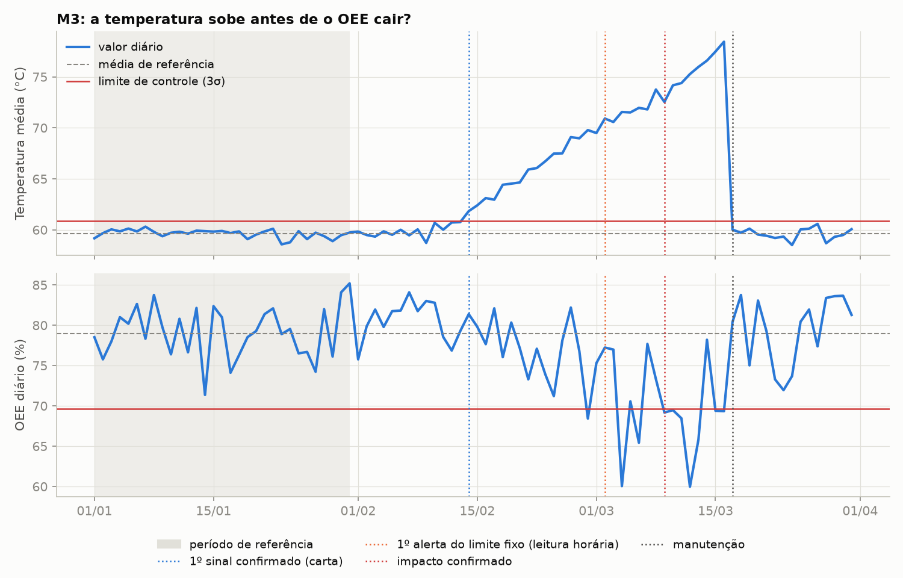
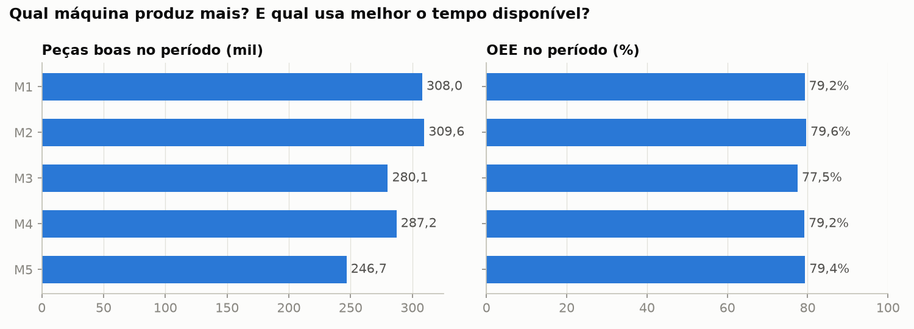
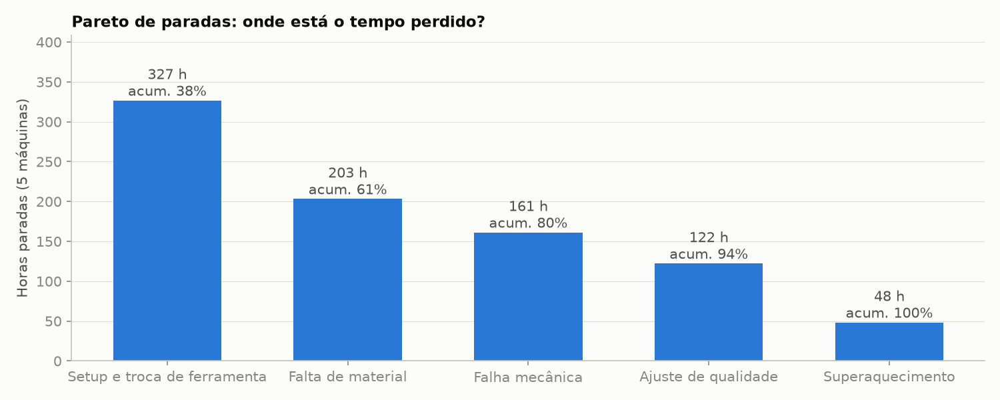
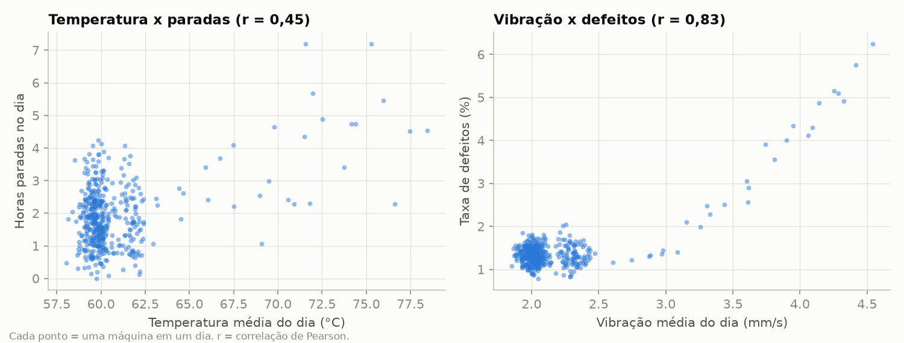
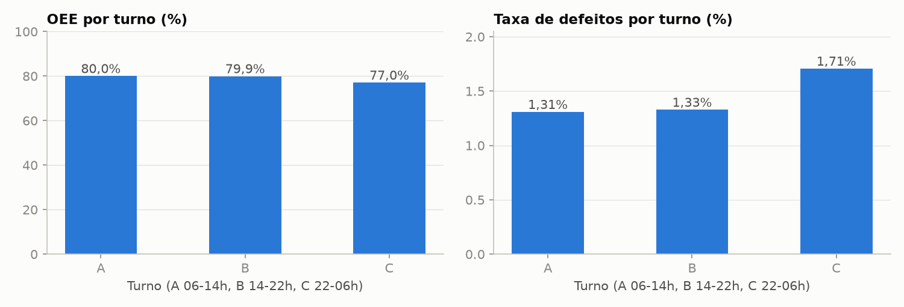
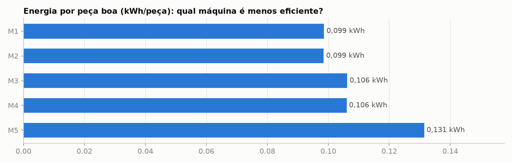
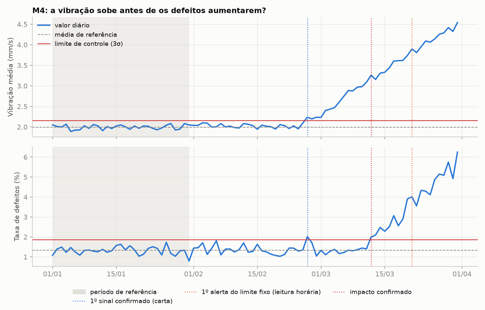

# Industrial Analytics: monitoramento de produção e manutenção

Projeto pessoal de análise de dados industriais. Simulei 90 dias de uma célula com 5 máquinas CNC e montei um pipeline em Python e SQL que limpa os dados, calcula indicadores de produção (OEE, defeitos, paradas) e usa carta de controle para avisar quando uma máquina começa a sair do comportamento normal, antes de a produção cair.

> Os dados utilizados neste projeto são sintéticos e foram criados exclusivamente para fins educacionais e de portfólio. O cenário é inspirado em problemas comuns de chão de fábrica e não representa nenhuma empresa real.



## O problema

Muitas falhas de equipamento dão sinais antes de parar a máquina: a temperatura sobe aos poucos, a vibração aumenta. Quem olha só para a produção do dia percebe tarde. A pergunta que guiou o projeto foi:

> Onde estão as perdas da célula e quais sinais mostram que uma máquina está saindo do controle antes de a produção ser afetada?

Para responder, o projeto:

- trata dados brutos com erros típicos (duplicatas, sensor sem leitura, valores impossíveis);
- calcula KPIs com definições explícitas;
- detecta comportamento fora do padrão com regras simples de explicar;
- mede quantos dias de antecedência o alerta dá em relação ao impacto na produção.

## A fábrica simulada

São 5 centros de usinagem CNC fazendo a mesma família de peças, em 3 turnos (A 06h-14h, B 14h-22h, C 22h-06h), de 01/01 a 31/03/2026 (datas fictícias). Cada linha do dataset é uma máquina em uma hora: 10.800 registros, mais 30 duplicatas colocadas de propósito.

Alguns problemas foram inseridos de propósito para a análise ter o que encontrar. Eles estão em `src/config.py`, e o código de detecção não usa essa informação:

| Máquina | O que foi simulado |
| --- | --- |
| M3 | Temperatura subindo a partir de 10/02 (como uma falha de refrigeração). Gera paradas por superaquecimento até a manutenção de 17/03 |
| M4 | Vibração crescente a partir de 25/02 (como desgaste de rolamento), que aumenta os defeitos. Não é corrigida |
| Turno C | Um pouco mais lento e com mais defeitos |
| M5 | Máquina mais antiga: mais lenta e com maior consumo de energia por peça, mas estável |
| Todas | Duplicatas, leituras de sensor vazias, código de erro 999 e produção negativa |

As variáveis se relacionam de forma simples. Temperatura acima de ~66 °C aumenta a chance de parada, vibração acima de 3,0 mm/s aumenta o refugo, e tempo parado reduz a produção.

Colunas principais: `timestamp`, `machine_id`, `shift`, `planned_minutes`, `downtime_minutes`, `downtime_reason`, `units_produced`, `defective_units`, `temperature_c`, `vibration_mm_s`, `energy_kwh` e `maintenance_flag`. O cadastro de máquinas traz a velocidade nominal (`ideal_rate_per_min`), necessária para calcular a performance do OEE.

## Ferramentas

- **Python (pandas, NumPy):** geração dos dados, limpeza, KPIs e detecção.
- **Matplotlib:** gráficos.
- **SQL (SQLite):** consultas analíticas com CTE e window functions. Escolhi SQLite porque o banco é um arquivo só e roda sem servidor; as consultas funcionam com poucas mudanças em MySQL ou PostgreSQL.
- **pytest:** testes das fórmulas, da limpeza e da detecção.

## Como o pipeline funciona

```
generate_data.py  ->  data/raw/          dados brutos com erros
transform.py      ->  limpeza, colunas derivadas e KPIs
anomalies.py      ->  limite fixo, carta de controle e aviso antecipado
                  ->  data/processed/    tabelas prontas para SQL e BI
analysis.py       ->  reports/           gráficos e summary.md
sql/              ->  carga no SQLite e consultas
```

Na limpeza, de 10.830 linhas brutas saíram 10.797. Foram removidas 30 duplicatas e 3 linhas com produção negativa. As 5 leituras com código de erro 999 viraram vazio, e as 112 leituras vazias foram preenchidas por interpolação dentro de cada máquina.

## Indicadores

| KPI | Cálculo |
| --- | --- |
| Disponibilidade | tempo operando / tempo planejado |
| Performance | tempo ideal para a produção realizada / tempo operando |
| Qualidade | peças boas / peças produzidas |
| OEE | disponibilidade × performance × qualidade |
| Taxa de defeitos | peças com defeito / peças produzidas |
| Meta atingida | peças boas / meta (80% da capacidade nominal) |
| Energia por peça | kWh / peças boas |

Todos os indicadores de razão são calculados como soma sobre soma, e não como média de percentuais. Uma hora com 10 peças e 50% de defeito não pode pesar o mesmo que uma hora com 190 peças e nenhum defeito. Há um teste para isso em `tests/test_transform.py`.

Premissas do OEE: peça com defeito não é retrabalhada, e a manutenção planejada não entra no tempo planejado de produção.

## O que os dados mostram

No período, a célula fez 1.431.643 peças boas, com OEE de 79,0% (disponibilidade 92,0%, performance 87,1%, qualidade 98,6%), 1,44% de defeitos e 862 horas paradas. Todos os números saem de `reports/summary.md`, gerado pelo código.

**Produção e OEE por máquina.**

- M2 (309.637 peças boas) e M1 foram as que mais produziram.
- A M3 teve o pior OEE (77,5%) e o maior tempo parado (213 h).
- A M5 produziu menos por ser mais lenta, mas o OEE dela (79,4%) ficou no nível de M1, M2 e M4.



**Defeitos.** A M4 fechou o período com 1,88% de refugo, contra cerca de 1,33% das outras.

**Paradas.** Setup e troca de ferramenta somam 38% das horas paradas; com falta de material, chegam a 61%. Superaquecimento ficou com apenas 5,6% do total.



**Temperatura x paradas e vibração x defeitos.**

- Temperatura e paradas têm correlação moderada (r = 0,45), que só aparece acima de ~65 °C.
- Vibração e defeitos têm correlação forte (r = 0,83), concentrada acima de 3,0 mm/s.



**Turnos.** A e B ficaram praticamente empatados (OEE de 80,0% e 79,9%). O turno C teve OEE de 77,0% e 1,71% de defeitos.



**Energia.** A M5 gasta cerca de 32% mais energia por peça que M1 e M2.



As mesmas perguntas estão respondidas em SQL em [`sql/queries.sql`](sql/queries.sql).

## Detecção de anomalias

A detecção usa duas regras.

A primeira é um **limite fixo**: leitura horária acima de 72 °C ou de 4,0 mm/s. São valores de exemplo. É simples, mas só avisa quando o problema já está grande.

A segunda é uma **carta de controle**:

- Para cada máquina, calculo média e desvio padrão de cada indicador diário usando só janeiro, que foi o período estável.
- Os limites ficam em média ± 3 desvios.
- Se o cálculo usasse os 90 dias, o próprio problema aumentaria o desvio padrão e os limites ficariam largos demais para pegá-lo.
- Um alerta só conta como confirmado depois de 2 dias seguidos fora do limite.

Separei os indicadores em sinal (temperatura e vibração) e impacto (OEE e defeitos). A distância entre o primeiro sinal e o primeiro impacto é o aviso antecipado.

| Máquina | Início simulado | 1º sinal (carta) | 1º alerta do limite fixo | Impacto confirmado | Aviso antecipado |
| --- | --- | --- | --- | --- | --- |
| M3 | 10/02 | 14/02 | 02/03 | 09/03 | 23 dias |
| M4 | 25/02 | 26/02 | 21/03 | 12/03 | 14 dias |



A M2 teve 4 dias isolados fora do limite e a M5 teve 1, nenhum deles confirmado. Limites de 3σ sempre deixam escapar algum alarme falso, e é para isso que serve a regra dos 2 dias.

Como os problemas foram simulados, essa tabela mostra que o método encontra o que existe, sem disparar antes do início. Ela não é uma descoberta sobre um processo real.

## Conclusões

1. A carta de controle avisou bem antes do limite fixo. Na M3, o sinal veio 16 dias antes do limite fixo e 23 dias antes da queda de OEE. Na M4, o limite fixo de vibração só disparou 9 dias depois de os defeitos já estarem fora de controle.
2. A manutenção da M3 resolveu o problema:

   | M3 | Temperatura média | OEE |
   | --- | --- | --- |
   | Janeiro (referência) | 59,6 °C | 78,9% |
   | 2 semanas antes da manutenção | 74,0 °C | 69,6% |
   | 2 semanas depois da manutenção | 59,6 °C | 79,4% |

3. A M4 precisa de intervenção. Nas duas últimas semanas, a vibração média foi de 4,05 mm/s (era 1,99 em janeiro) e os defeitos chegaram a 4,41% (eram 1,32%).
4. Na célula como um todo, a maior oportunidade está em setup e falta de material, que somam 61% das horas paradas. O superaquecimento da M3 pesa muito na máquina, mas pouco no total.
5. O turno C perde cerca de 3 pontos de OEE e tem mais defeitos. Os dados mostram onde está a diferença, mas não a causa: treinamento, iluminação ou abastecimento são hipóteses a verificar.
6. A M5 consome mais energia sem gerar nenhum alerta confirmado. É uma característica de máquina antiga, assunto para avaliação de investimento, e não para manutenção corretiva.

Para acompanhar no dia a dia, eu monitoraria:

- temperatura e vibração diárias de cada máquina, com carta de controle;
- o OEE e seus três componentes;
- os defeitos por máquina e por turno;
- o Pareto semanal de paradas.

## Limitações

- Os dados são sintéticos e as relações entre as variáveis foram definidas por mim. Encontrar os problemas valida a lógica de detecção, mas não diz nada sobre uma fábrica real.
- Correlação não é causalidade. Aqui a causa é conhecida porque foi simulada; com dados reais, precisaria ser investigada.
- Cada hora registra um único motivo de parada, e não há registro de cada falha individual. Por isso não calculei MTBF nem MTTR.
- A operação é contínua (24h, todos os dias) e os indicadores diários usam a data do calendário, mesmo o turno C atravessando a meia-noite.

## Próximos passos

- Dashboard em Power BI com visão geral, comparação entre máquinas e alertas.
- Regras de tendência na carta de controle (vários pontos seguidos acima da média).
- Leitura de sensores reais, por exemplo com ESP32 enviando dados via MQTT.

## Como executar

Precisa de Python 3.10 ou mais recente. No Windows, use `py`, que funciona mesmo quando o comando `python` não está no PATH:

```powershell
py -m pip install -r requirements.txt
py src/main.py             # gera os dados, limpa, calcula KPIs, detecta anomalias e cria os gráficos
py sql/load_sqlite.py      # carrega no SQLite e roda as consultas
py -m pytest               # testes
```

No Linux ou Mac, troque `py` por `python3`. A seed é fixa (`SEED = 42`), então toda execução gera os mesmos dados e resultados.

```
industrial-analytics/
├── data/raw/          dados brutos gerados
├── data/processed/    tabelas limpas, KPIs diários, limites e alertas
├── src/               config, geração, transformação, anomalias, análise e main
├── sql/               carga no SQLite e consultas
├── reports/           gráficos e summary.md
└── tests/
```

## Uso de IA

Usei IA generativa (Claude) como apoio para estruturar o projeto, gerar parte do código, revisar e documentar. As decisões técnicas (escopo, definição dos KPIs, método de detecção, premissas e limitações) foram revisadas por mim, e os resultados vêm da execução do código, conferida pelos testes.

---

Rafael Maschietto Mastromauro · Engenharia da Computação, FACENS · [LinkedIn](https://www.linkedin.com/in/rafaelmaschietto/) · [rafammastro@gmail.com](mailto:rafammastro@gmail.com)
